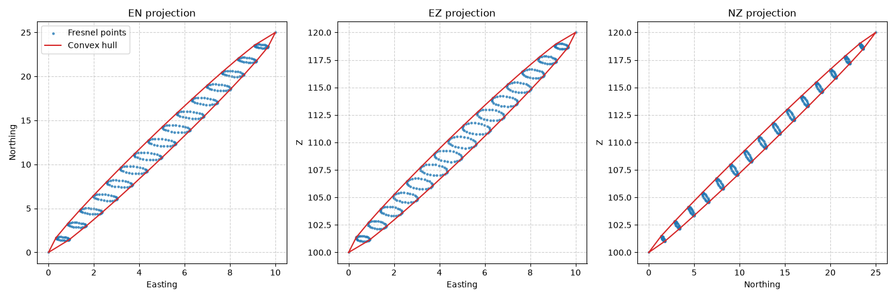

# Fresnel Zone Toolbox

## Background
The Fresnel zones are a series of concentric, ellipsoidal regions surrounding the direct line-of-sight (LOS) path between the two antennas. Ideally, the first Fresnel zone will be completely clear of obstructions, but as a rule-of-thumb, 60% clearance is enough to ensure connectivity. 



### What this project does
This project takes coordinates of the two transmitters/receivers, the frequency that they're transmitting at, and gives the points along the surface of the Fresnel zone that they create.  

## Approach

1. Start by creating a heading vector between two transmitters/receivers $\overrightarrow{AB}$.

2. Find equidistant points along the vector $\overrightarrow{AB}$. These are the points where the rings will go around.

3. At each one of these points, calculate the radius of the Fresnel zone around it using the formula:

$$r_n = \sqrt\frac{n × λ × d_1 × d_2}{d_1 + d_2} $$

where:

| Symbol | Description |
|--------|---------|
| $r_n$  | Radius of the nth Fresnel zone (m) |
| $λ$    | Wavelength of the signal being transmitted (m) |
| $d_1$   | Distance from point to point $A$ (m) |
| $d_2$   | Distance from point to point $B$|
| $n$    | Zone number (usually 1) |


4. Create a vector $w$ with the tail at the midpoint of length $r_n$ which is orthogonal to the heading vector $\overrightarrow{AB}$ and upwards (in the Z direction). 

5. Rotate $w$ around the heading vector $\overrightarrow{AB}$. 

6. Save the tips of the vectors $w$.

 
## How to reproduce

```bash
# 1. Clone the repo
git clone https://github.com/BenSmithNZL/FresnelZoneToolbox.git
cd [the_chase]

# 2. Create an environment and install dependencies
python -m venv .venv
source .venv/bin/activate  # Windows: .venv\Scripts\activate
pip install -r requirements.txt
```

## Example

```python
import core
import visualise
import numpy as np

A = np.array([0, 0, 100])
B = np.array([10, 25, 120])
frequency_hz = 6e9

points = core.fresnel_zone_points(
    A, 
    B, 
    num_of_rings=15, 
    num_of_points_per_ring=25, 
    frequency_hz=frequency_hz
)

core.save_points_to_csv(points, "example_points.csv")

visualise.plot_fresnel_zone(points)
```

## Next steps
- **Create ArcGIS Pro Toolbox:** Create a toolbox from this to quickly create a 3D object from the points saved.

## Licence

This project's code and notebooks are released under the [MIT Licence](LICENSE).

## Contact

**Ben Smith**: [LinkedIn](https://www.linkedin.com/in/ben-smith-806350130) · [GitHub](https://github.com/BenSmithNZL) · [Email](mailto:bsmithnzl108@gmail.com)